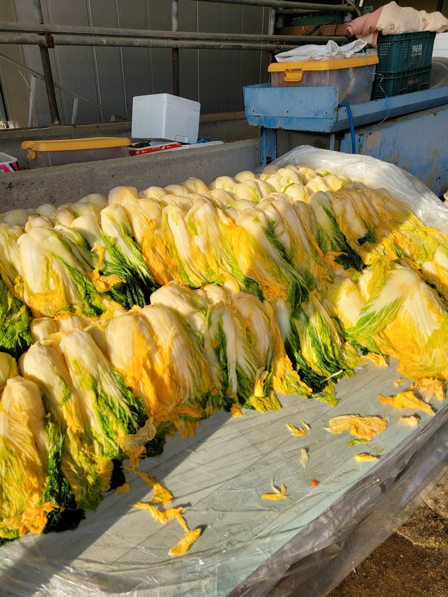
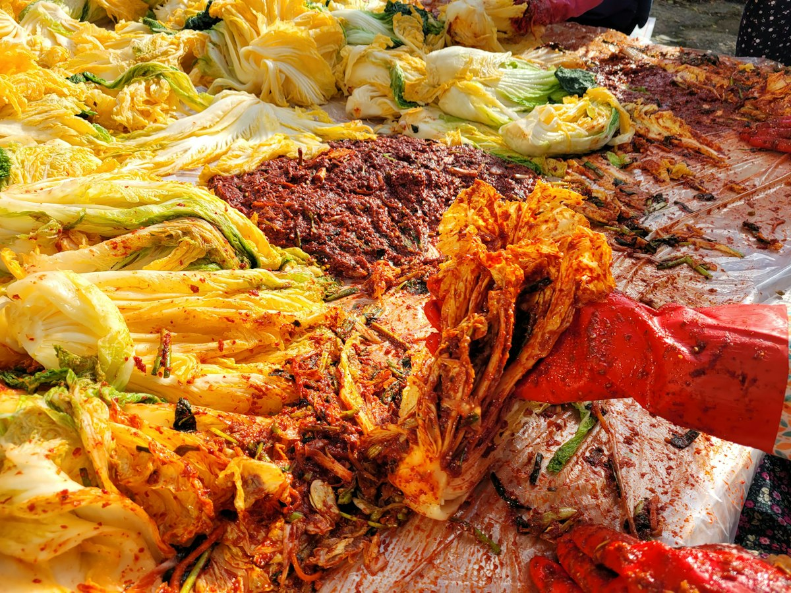
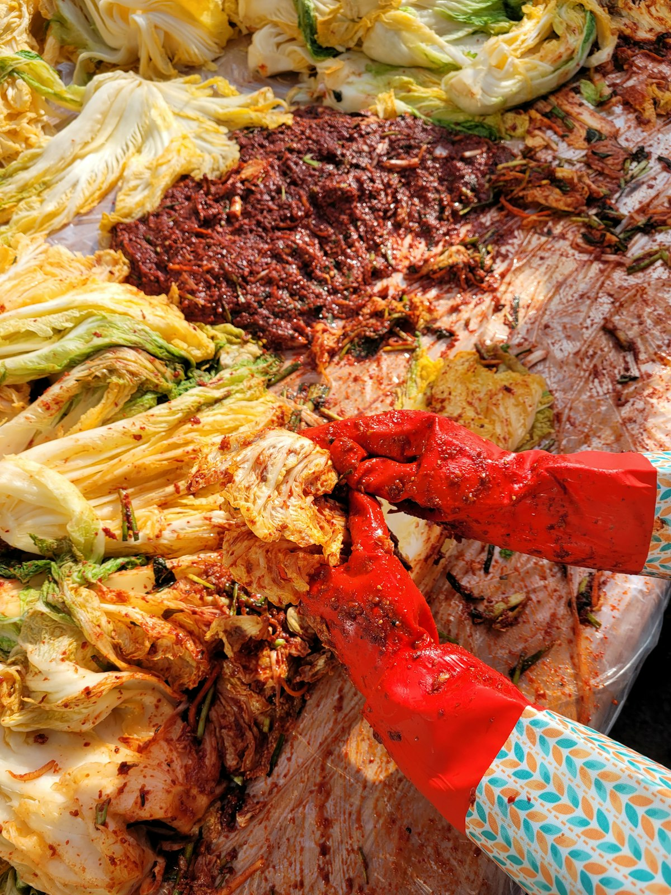
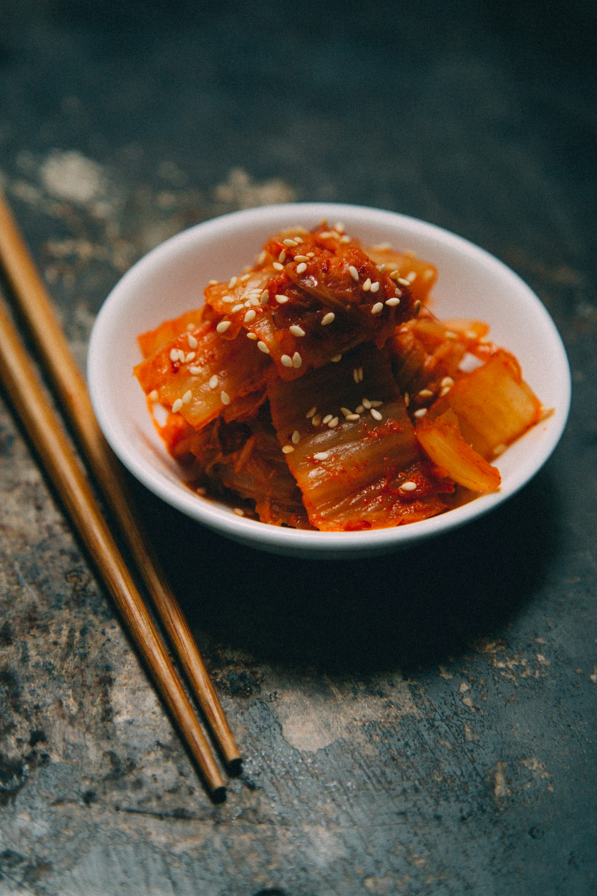

# 2026 김장 비용 총정리, 배추는 싸고 새우젓은 32% 올랐다

- Blog ID: lovejeaen
- Source: research/kimjang_cost_2026/kimjang_cost_2026.md (v1: output/blog/2026_김장_비용_총정리.md 보강·수정판)
- Written: 2026-10-31

---

벌써 김장 시즌이 다가왔어요. 올해는 "배추는 싸졌는데 왜 김장 비용은 생각보다 안 내릴까?" 하는 이야기가 많더라고요.

배추값은 크게 내렸지만 새우젓이 많이 올랐기 때문이에요. 오늘은 2026년 김장 물가를 최신 시세로 정리하고, 할인 행사와 아끼는 방법까지 알려 드릴게요.

사진: huiyeon kim / Unsplash (배추 소금 절이기)

## 1. 올해 김장 물가 한눈에 보기

aT KAMIS 소매가격(2026년 10월 30일 기준)으로 주요 품목을 정리했어요.

| 품목 (단위) | 10/30 가격 | 전년 대비 |
|---|---|---|
| 배추 (1포기) | 3,969원 | 13.0% 하락 ▼ |
| 무 (1개) | 2,038원 | 1.5% 하락 ▼ |
| 고춧가루 (국산 1kg) | 31,200원 | 1.2% 상승 (보합) |
| 깐마늘 (국산 1kg, 상품) | 12,150원 | 10.1% 상승 ▲ |
| 쪽파 (1kg) | 4,980원 | 45.5% 하락 ▼ |
| 대파 (1kg) | 2,274원 | 23.0% 하락 ▼ |
| 생강 (국산 1kg) | 11,395원 | 0.2% 상승 (보합) |
| 굴 (1kg) | 19,976원 | 1.8% 하락 ▼ |
| 새우젓 (1kg) | 19,025원 | 28.3% 상승 ▲ |
| 멸치액젓 (1kg) | 5,845원 | 0.5% 상승 (보합) |
| 천일염 (5kg) | 11,243원 | 0.7% 상승 (보합) |

※ 출처: aT KAMIS 소매가격 (2026-10-30). 전년 대비는 KAMIS 화면의 '1년 전' 값으로 계산한 수치예요.
※ 시세는 매일 바뀌니 장보기 전에 KAMIS에서 한 번 더 확인해 주세요.

제목의 "새우젓 32%"는 **10월 16일 aT 기준** 수치예요(1kg 20,269원, +32.5%). 10월 30일 KAMIS 기준으로는 19,025원, 전년보다 28.3% 오른 상태예요.

**✔ 정정 안내**
이전 글에서 "무 32% 이상 상승"이라고 썼는데, 지금 소매가 기준으로는 맞지 않아요. +32%는 10월 6일 보도 수치였고, 무 소매가는 10월 16일 전년 대비 -7.1%, 10월 30일 -1.5%로 오히려 조금 내렸어요. 바로잡습니다.

## 2. 배추가 싼 이유와 사기 좋은 시기

사진: huiyeon kim / Unsplash (김장 양념 버무리기)

배추는 1포기 6,256원(10/6) → 5,557원(10/16) → 3,969원(10/30)으로 계속 내려오고 있어요. 올해 가을배추 생산량이 122만 2천 t으로 전년보다 19.3% 늘 전망이라 공급이 넉넉하거든요.

배추가 싼 이유는 이렇게 정리돼요.

- 날씨가 좋아 작황이 좋았어요
- 늦어진 여름배추 출하와 가을배추 출하가 겹쳤어요
- 가을배추 단수(면적당 수확량)가 전년보다 21.4% 늘었어요

**사기 좋은 시기 (팁)**

- 언론 보도에 따르면 11월 중순 이후 더 내려갈 전망이에요
- 11월 9일 정부 대책이 시작된 뒤에 사면 할인 혜택을 더 받을 수 있어요
- 절임배추는 20kg 기준 이마트 29,800원(1차, 정상가 49,800원), 롯데마트 해남산 29,900원(작년 39,990원)이에요. 둘 다 행사카드 결제 기준이에요.

※ 구매 시기는 보도 내용을 바탕으로 한 팁이며 공식 권고는 아니에요.
※ 롯데마트 가격은 일부 미검증 자료예요. 이마트 2차는 35,800원이에요.

## 3. 새우젓이 오른 이유와 아끼는 방법

올해 김장 비용의 복병은 새우젓이에요. 새우 어획이 부진해서 2026년 1~8월 생산량이 약 9,500t으로 3.5% 줄었어요. 새우젓은 3~6개월 숙성하기 때문에 7월 이후 생산 감소가 지금 가격에 반영되고 있어요.

작년 가격이 낮았던 탓에 상승률이 더 커 보이는 면도 있어요. 해양수산부는 김장철이 끝날 때까지 가격이 크게 내리기 어렵다고 봤어요.

다른 양념은 이렇게 움직였어요.

- **마늘**: 저장량이 줄어 상품 기준으로 올랐어요(엇갈림·최근 상승). 중품은 1kg 9,813원으로 상품(12,150원)보다 싸요
- **고춧가루**: 거의 보합이에요
- **무·쪽파·대파·생강**: 공급이 충분해 내렸거나 보합이에요

**아끼는 방법 (팁)**

- 작년 김장 기록을 보고 새우젓 필요량을 미리 계산하기
- 이웃·가족과 대용량을 나눠 사기
- 새우젓·액젓·천일염·굴은 수산물 할인 행사 기간에 사기 (아래 4번 참고)
- 2025년 조사들에서는 전통시장이 대형마트보다 10.8~20.7% 저렴했어요

## 4. 정부 김장 물가 대책과 할인 행사

사진: huiyeon kim / Unsplash (양념 버무린 김장 배추)

**① 해수부 '코리아 수산 페스타' (진행 중)**

- 기간: 2026년 10월 28일 ~ 11월 29일
- 할인: 최대 50% (정부 지원 20% + 업체 자체 할인), 정부 지원은 1인 1만 원 한도
- 품목: 새우젓, 멸치액젓, 천일염, 굴 등
- 판매처: 56개 업체 (오프라인 24곳, 온라인 32곳), 자세한 내용은 fsale.kr

**② 농식품부·해수부 김장 대책 (11월 9일 시행 예정)**

- 재료 공급 확대와 할인 행사 지원이 예정돼 있어요
- 다만 **할인율, 한도, 판매처 등 세부 내용은 10월 31일 현재 아직 발표 전**이에요
- 마늘 할인도 검토 중이라고 하니, 마늘은 대책 발표를 보고 사는 것도 방법이에요

※ 세부 혜택이 발표되면 이 글에 업데이트할게요.

## 5. 우리 집 김장 비용 계산해 보기

사진: charlesdeluvio / Unsplash (김치)

먼저 참고할 만한 숫자예요.

- **2026년 aT 공식 4인 가족 김장 비용**: 아직 발표 전이에요 (작년엔 11월 18일 발표)
- **2025년 aT 공식 (4인, 배추 20포기)**: 201,151원 (2025-11-17 기준, 할인 반영)
- **2026년 민간 추산 (아시아경제)**: 263,929원 (aT 10/16 소매가 기준, 전년 같은 시기보다 -6.4%)

※ 위 두 금액은 조사 시점과 방식이 달라 직접 비교하기 어려워요. 민간 추산은 공식 수치가 아니에요.

**계산 예시 (단가는 10/30 KAMIS 기준, 수량은 예시예요)**

| 품목 | 단가 | 4인 가족 (예시) | 1~2인 가구 (예시) |
|---|---|---|---|
| 배추 | 3,969원/포기 | 20포기 = 79,380원 | 10포기 = 39,690원 |
| 무 | 2,038원/개 | ( )개 = ( )원 | ( )개 = ( )원 |
| 고춧가루 | 31,200원/kg | ( )kg = ( )원 | ( )kg = ( )원 |
| 깐마늘 | 12,150원/kg | ( )kg = ( )원 | ( )kg = ( )원 |
| 쪽파 | 4,980원/kg | ( )kg = ( )원 | ( )kg = ( )원 |
| 새우젓 | 19,025원/kg | ( )kg = ( )원 | ( )kg = ( )원 |
| 멸치액젓 | 5,845원/kg | ( )kg = ( )원 | ( )kg = ( )원 |
| 천일염 | 11,243원/5kg | ( )포대 = ( )원 | ( )포대 = ( )원 |
| **합계** | | **( )원** | **( )원** |

※ 수량은 이해를 돕기 위한 예시예요. 집마다 사용량이 다르니 우리 집 기준으로 채워 보세요.

**직접 담그기 vs 절임배추 vs 포장김치**

| 방법 | 참고 가격 | 장단점 |
|---|---|---|
| 배추부터 직접 | 재료비 약 26만 4천 원 (민간 추산) | 가장 저렴할 수 있지만 절이는 노동이 큼 |
| 절임배추 구매 | 20kg 약 3만 원 (행사카드 기준) | 시간·노동을 크게 줄임 |
| 포장김치 | 10kg 종가 50,000원 / 비비고 58,500원 | 손이 안 가지만 40kg이면 약 20만~40만 원 |

※ 포장김치 40kg 환산은 경향신문(약 20만~23만 4천 원)과 아시아경제 업계 추정(약 30만~40만 원)으로 기준이 달라요.

## 마무리

올해 김장은 배추·무·파는 싸고, 새우젓은 비싼 해예요. 새우젓·액젓은 지금 진행 중인 코리아 수산 페스타(~11/29)를 활용하고, 배추와 마늘은 11월 9일 정부 대책을 확인한 뒤 사면 비용을 꽤 아낄 수 있어요.

aT 공식 2026년 김장 비용과 정부 대책 세부 내용이 발표되면 바로 업데이트할게요. 여러분의 올해 김장 계획도 댓글로 나눠 주세요!

---

#김장비용 #2026김장 #김장물가 #배추가격 #새우젓가격 #절임배추 #김장물가대책 #코리아수산페스타 #김장준비 #살림정보
