# Entropy (엔트로피) — Web Design References

- Date: 2026-11-01
- Topic / page goal: A Korean, one-page science explainer that introduces entropy to a general audience through scroll-driven storytelling (hook → concept → interactive demos → history → information → universe → myths & key numbers).
- Sources searched: GDWEB, DBCUT (Pinterest excluded)
- Content basis: `output/research/entropy/entropy_research.md` (section plan, stat cards, interactive ideas)

### What the page must show (brief)
- One idea per screen: coffee cooling / ink spreading hook, microstates vs macrostates, the second law, a timeline (Carnot → Shannon), information entropy, arrow of time / black holes / heat death, myths and stat cards.
- Audience: Korean general readers and students; must work well on mobile.
- Mood: curious and friendly copy on a calm "space/physics" visual base; big numbers and big type; one or two interactive demos (particle box, coin counter).

## Summary
- **Full-screen, one-message sections** are the common pattern in every science/space reference: dark imagery, a single centred or bottom-left headline, one short paragraph and one button. This fits "one idea per screen".
- **Dark cosmic base + one accent colour** works best (black/navy + orange, or black + violet). For entropy, a **warm → cool** accent pair (heat/order → spread/cold) can carry the story itself.
- **Scroll-driven reveal** is used for storytelling: lines of text fade from dim to bright as you scroll (Hanwha Aerospace), images grow from an inset card to full-bleed (Hanwha Aerospace), objects travel along an orbit path (Space Hub).
- **Structured info blocks on dark backgrounds**: a 4-step process/timeline bar with arrows (Space Pebble), 3 translucent "learning hub" cards over a photo (KASI), and side dot navigation for section progress (IBS 10th).
- Recommended direction: dark navy "space" base, big Korean headlines, scroll-reveal text, a horizontal timeline, big-number stat cards, and a canvas particle demo for the hero; keep copy friendly as the research suggests.

## Reference list
| # | Title | Site | Link | Screenshot |
|---|-------|------|------|------------|
| 1 | 기초과학연구원 10주년 (IBS 10th Anniversary) | GDWEB | https://www.gdweb.co.kr/sub/view.asp?Txt_fgbn=5&str_no=18651 | images/ref01_gdweb_ibs-10th.png |
| 2 | Space Hub (Hanwha) | DBCUT | https://www.dbcut.com/websites/24350 | images/ref02_dbcut_space-hub.png (+ _hero, _scroll) |
| 3 | 한화 우주의조약돌 (Hanwha Space Pebble × KAIST) | GDWEB | https://www.gdweb.co.kr/sub/view.asp?Txt_fgbn=5&str_no=19386 | images/ref03_gdweb_hanwha-space-pebble.png (+ _detail, _detail2, _detail3) |
| 4 | 천문우주지식정보 (KASI Astronomy Knowledge) | GDWEB | https://www.gdweb.co.kr/sub/view.asp?Txt_fgbn=5&str_no=9047 | images/ref04_gdweb_kasi-astro.png |
| 5 | 한화에어로스페이스 (Hanwha Aerospace) | DBCUT | https://www.dbcut.com/websites/24033 | images/ref05_dbcut_hanwha-aerospace.png (+ _hero, _section) |

## 1. 기초과학연구원 10주년 (IBS 10th Anniversary)
- Link: https://www.gdweb.co.kr/sub/view.asp?Txt_fgbn=5&str_no=18651 (live site: http://www.ibs.re.kr/10th)
- Screenshot: 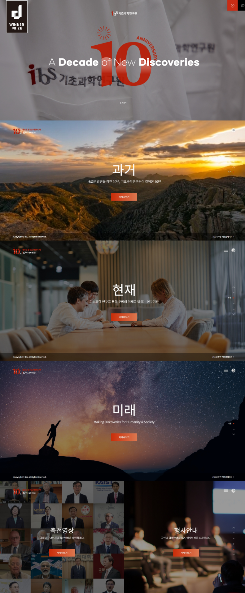
### Design
- Colors: full-bleed photos darkened with a black overlay; white text; one red-orange accent for the "10" mark and the CTA buttons (estimate ~#E5432A); thin dark footer bar.
- Typography: bold Latin display line in the intro ("A Decade of New Discoveries", mixed weights: bold + light in one line); large Korean section titles (estimate ~60px) with a small one-line sub-copy below.
- Tone & imagery: cinematic and calm; landscape at sunset (past), people at work (present), a person under the Milky Way (future). Space imagery is used for "future/universe" — a good match for a cosmic finale.
### Layout
- Structure: intro splash (logo animation + SKIP) → full-screen "Past" → "Present" → "Future" → split screen (video greetings | events) → footer bar in every section.
- Grid / spacing: each section = 100vh, content centred both ways; a lot of empty space around a three-line message block (title / sub-copy / button).
- Components: small rectangular accent button; right-side vertical dot navigation with the active label; top-left mini logo, top-right menu icon.
### Interaction
- Full-page section snapping (one wheel = one section, inferred from the dot nav); intro animation with a skip link.
### What to borrow
- **Time-as-a-story structure** (past → present → future) maps directly onto entropy's "arrow of time" and the history timeline.
- Right-side dot navigation with section labels to show progress in a long one-pager.
- The 3-line message block (big title / one sentence / one button) as the default section unit.
### What to avoid
- Hard full-page snapping: it can trap readers on mobile and hides content between snaps; use normal scroll with reveal effects instead.

## 2. Space Hub (Hanwha)
- Link: https://www.dbcut.com/websites/24350 (live site: https://www.hanwhaspacehub.com/)
- Screenshot: 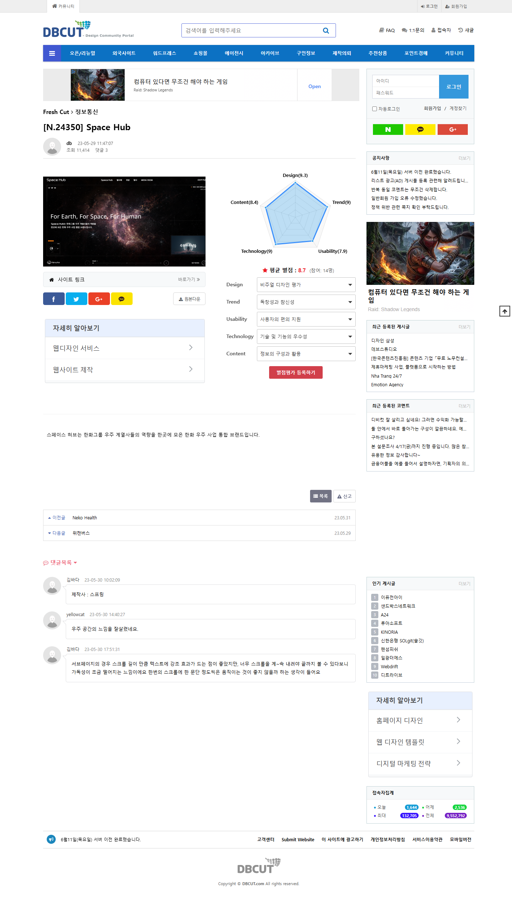 · 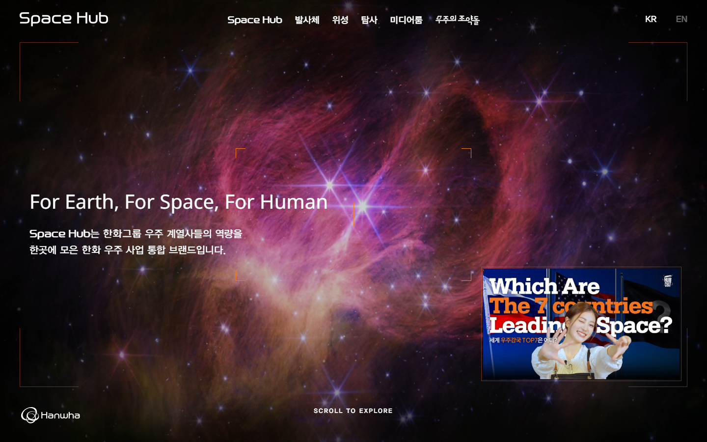 · 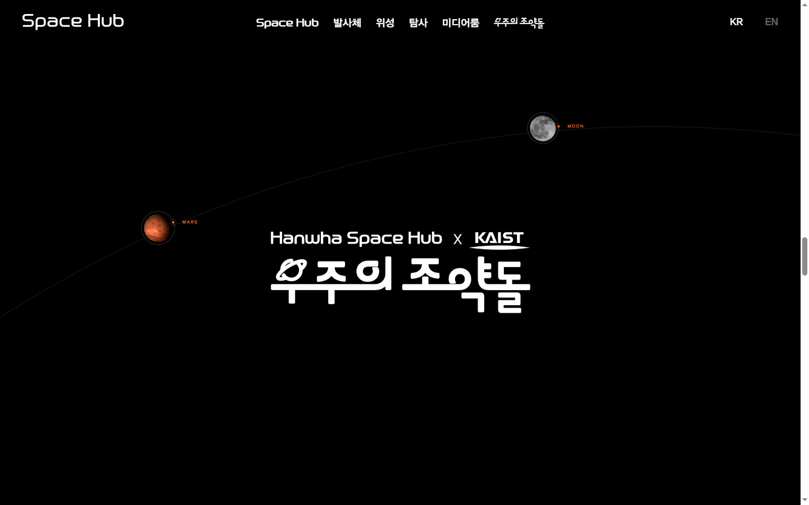
### Design
- Colors: pure black page background (measured `rgb(0,0,0)`); nebula image in magenta/violet in the hero; thin orange corner brackets and small orange labels (estimate ~#D2692E); white text.
- Typography: geometric, techno-style display face for the brand and nav (custom font family "YDIYGO" measured); hero headline in Noto Sans at 40px (measured); story headings 28px (measured); body 16–20px.
- Tone & imagery: cinematic space — nebula, rocket launch, Earth, Moon rover; very dark, high contrast.
### Layout
- Structure: fixed transparent header (logo / centred nav / KR-EN) → full-screen hero with "viewfinder" corner frame and bottom "SCROLL TO EXPLORE" → long pinned scroll scenes (launch → Earth → Moon) → program intro with planets on an orbit path → footer with oversized wordmark.
- Grid / spacing: hero text left-aligned at ~60px from the edge; scroll scenes centred; generous black space between scenes.
- Components: corner-bracket frame (HUD look), small video card bottom-right in the hero, dashed orbit line with planet nodes and tiny orange labels (MARS, MOON).
### Interaction
- Scroll-driven scenes: images and text appear only while their scene is in view (the full-page capture is mostly black because content is revealed on scroll).
- Planets move along a dashed orbital arc as you scroll.
### What to borrow
- **HUD corner-bracket frame** around the hero as a "measuring instrument" motif for physics.
- **Orbit/arc path with labelled nodes**: reuse as a timeline path (Carnot → Clausius → Boltzmann → Gibbs → Shannon) or a "cosmic timeline" from Big Bang to heat death.
- "Scroll to explore" cue in the hero.
### What to avoid
- Very long empty black scroll distances (the DBCUT comments also noted readability dropped because the scroll was too long). Keep each pinned scene short and keep text visible without animation if JS fails.

## 3. 한화 우주의조약돌 (Hanwha Space Pebble × KAIST)
- Link: https://www.gdweb.co.kr/sub/view.asp?Txt_fgbn=5&str_no=19386 (live site: https://www.thespacekids.com/main)
- Screenshot: 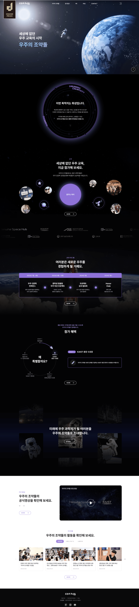 · 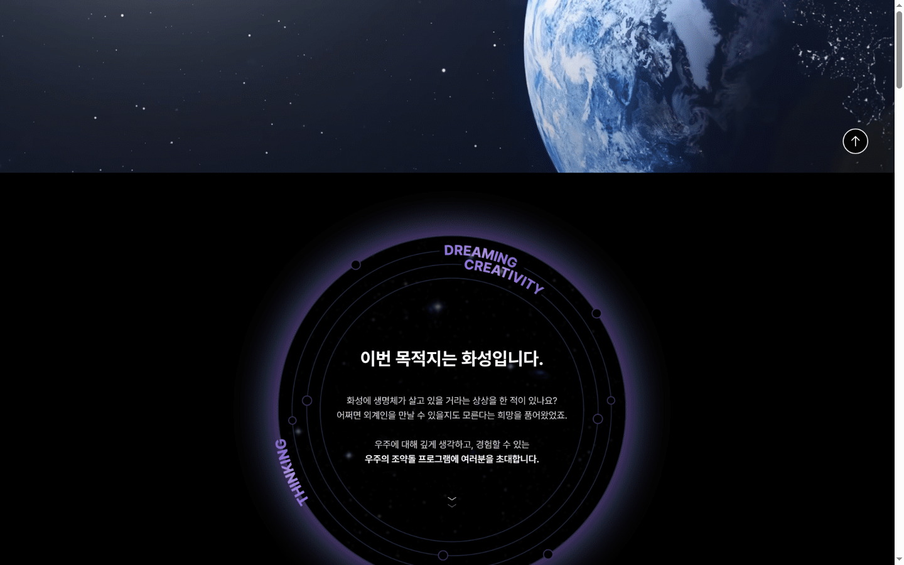 · 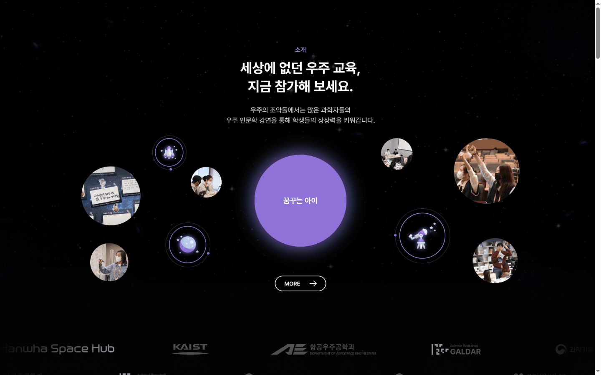 · 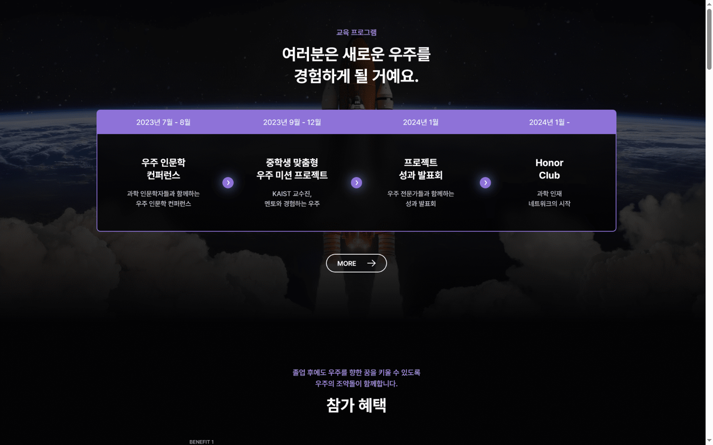
### Design
- Colors: black/very dark navy base (estimate #000–#0B0B14); one soft violet accent (estimate ~#8B6FDF) for labels, the central circle, the timeline header bar and arrow dots; white headings, light grey body (estimate ~#C9C9D1); a white section near the end for media/news.
- Typography: clean Korean sans (Pretendard-like, estimate); bold 2-line section titles (~36–40px est.) centred, with a small violet eyebrow label above ("소개", "교육 프로그램"); body ~15–16px, centred, 2 lines.
- Tone & imagery: educational and friendly but still cosmic — Earth, astronaut, rocket, plus round photo bubbles of students and line icons (rocket, moon, telescope).
### Layout
- Structure: hero (Earth + astronaut, big 3-line Korean title left) → circular "mission" panel with rotating ring text → intro with a central violet circle surrounded by floating photo/icon bubbles → partner logo marquee → 4-step program timeline → circular benefits diagram + detail card → CTA over a photo collage → video block → news cards → footer.
- Grid / spacing: centred single column for headings; 4-column timeline inside a rounded, violet-bordered box; 4-column news cards; large vertical spacing (~150–200px est.) between sections.
- Components: **glowing ring panel** with orbit dots and curved text; **floating bubble cluster**; **step timeline bar** (date header row + 4 steps joined by circular arrow buttons); pill-shaped outline "MORE →" buttons; logo marquee.
### Interaction
- Ring text likely rotates and bubbles likely float (estimates from the static capture); logo strip is a horizontal marquee.
### What to borrow
- **The ring panel** as the hero or "What is entropy?" frame (a closed system boundary, with particles inside).
- **The 4-step timeline bar** for "Story of a word" (1824 → 1865 → 1877 → 1948) or for the second-law steps (hot → heat flows → equal temperature → ΔS > 0).
- **Floating bubble cluster** as a visual for microstates (many small circles around one macrostate).
- Eyebrow label + 2-line centred title as the section header pattern; pill outline buttons.
### What to avoid
- Too many decorative bubbles/photos on mobile — reduce to a simple stacked list below 768px.

## 4. 천문우주지식정보 (KASI Astronomy & Space Knowledge)
- Link: https://www.gdweb.co.kr/sub/view.asp?Txt_fgbn=5&str_no=9047 (live site: http://astro.kasi.re.kr/)
- Screenshot: 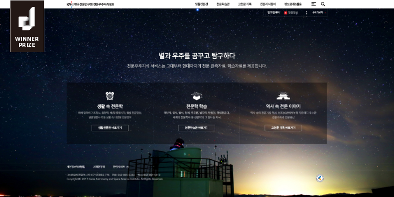
### Design
- Colors: one full-screen night-sky photo (deep navy/blue with a warm horizon glow); translucent dark card panel (estimate rgba(0,0,0,0.45)); white text; thin white outline buttons.
- Typography: centred medium-weight Korean headline (~32px est.) with one grey sub-line; small line icons above card titles.
- Tone & imagery: quiet and minimal, "study under the stars"; strong single photo, no clutter.
### Layout
- Structure: thin top bar (logo left, 4-item nav right) → one-screen hero headline + sub-line → 3-column translucent card panel (icon / title / 2-line description / outline button) → footer text overlaid on the same photo.
- Grid / spacing: content max width ~1040px est., 3 equal columns separated by thin dividers.
- Components: icon + title + description + outline button card; translucent glass panel.
### Interaction
- Mostly static (one-screen hub); hover state on buttons expected.
### What to borrow
- **Three translucent glass cards over a starfield** for a "Three ways to see entropy" section: energy spreading / counting microstates / information (bits).
- Quiet, minimal hero with a single line icon set — keeps a science page calm and readable.
### What to avoid
- Small low-contrast grey text over the photo; on our page keep body text at least 16px and ensure WCAG AA contrast.

## 5. 한화에어로스페이스 (Hanwha Aerospace)
- Link: https://www.dbcut.com/websites/24033 (live site: https://www.hanwhaaerospace.com/kor/index.do)
- Screenshot: 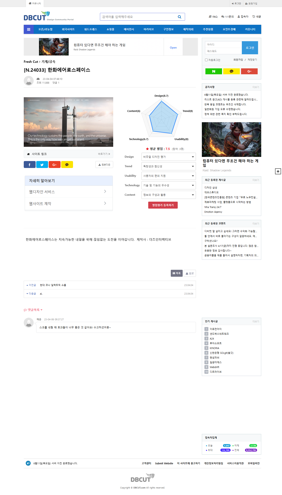 · 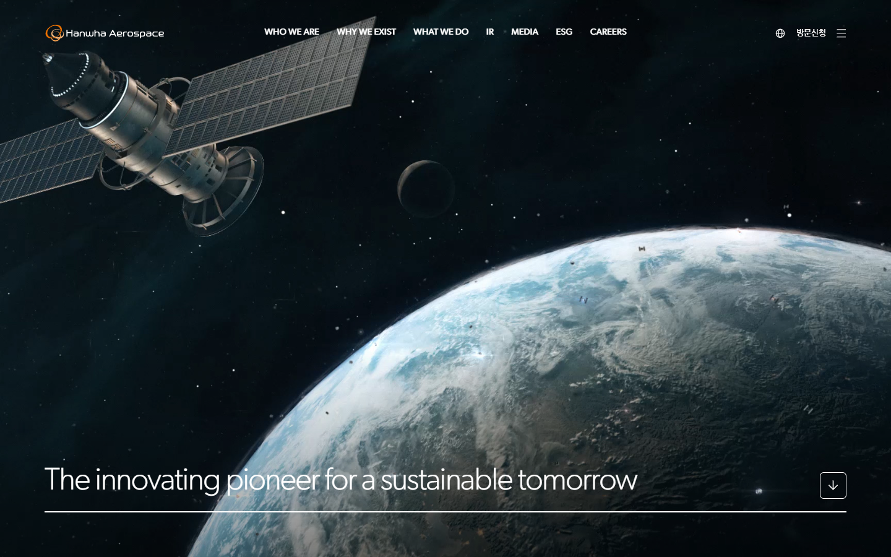 · 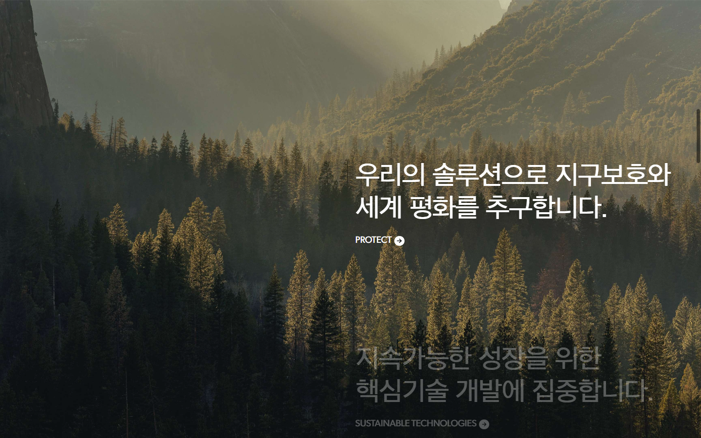
### Design
- Colors: dark space video hero (black/deep blue, Earth); then a white section with black text (measured `rgb(0,0,0)` heading); warm forest photo section with white text; orange brand accent only in the logo.
- Typography: corporate Korean sans ("HanwhaGothic" measured); very large Korean section heading at ~66px (measured); thin, light Latin hero line (~60px est.) with tight tracking and a full-width underline rule.
- Tone & imagery: premium, calm, cinematic; few words, huge type.
### Layout
- Structure: transparent header (logo / uppercase nav / menu icon) → full-screen video hero with one-line slogan at bottom-left + square scroll-down button → white statement section with a giant 2-line headline → image that expands from an inset card to full-bleed → pinned image with stacked statements on the right.
- Grid / spacing: 12-column feel with ~72px side margins; statements placed in the right half; very generous whitespace.
- Components: bottom-left slogan + hairline rule; square outline arrow button; "PROTECT →" small caps link with a circle arrow.
### Interaction
- **Scroll-scrubbed text**: the active statement is bright white, the next one is dimmed grey and brightens as you scroll.
- **Image expand on scroll**: an inset rounded image grows to full width.
- Header turns to a frosted bar when scrolling.
### What to borrow
- **Dim → bright statement reveal** for walking through the second law one sentence at a time.
- **Image/canvas that grows from a card to full screen** as a metaphor for "spreading out" (low → high entropy).
- Bottom-left giant slogan + hairline + square scroll button in the hero.
### What to avoid
- Over-reliance on video backgrounds (heavy on mobile); use a lightweight canvas or CSS gradient instead.

## Recommended direction for this topic
- **Overall tone**: "a calm night sky with a warm cup of coffee" — dark, minimal and cosmic, but the copy is curious and friendly (questions as headlines: "왜 커피는 저절로 다시 뜨거워지지 않을까?"). One idea per screen, big type, few words; equations appear once and are explained in words.
- **Color palette** (proposal, not taken from any site):
  - Background: deep space navy `#0B0E1A`, surface `#141A2E`, card glass `rgba(255,255,255,0.06)` with a `rgba(255,255,255,0.12)` border
  - Text: `#F2F4F8` (primary), `#A9B1C6` (secondary)
  - Accent "heat / low entropy": warm orange `#FF7A3D`
  - Accent "spread / high entropy": cool violet-blue `#7C8CFF`
  - Gradient `#FF7A3D → #7C8CFF` used for the entropy meter, timeline line and key numbers (heat spreading into cold)
  - Optional light band for the myths section: `#F5F6FA` with `#0B0E1A` text (gives a breathing pause in a long dark page)
- **Typography**: Korean sans **Pretendard** or **Noto Sans KR** (Google Fonts) — headlines 700 weight, 40–64px desktop / 28–36px mobile (`clamp()`), body 17–18px, line-height 1.7; numbers and equations in a monospace/tabular face (e.g. **JetBrains Mono** or **IBM Plex Mono**) to feel "scientific"; small uppercase English eyebrow labels with letter-spacing (e.g. "01 · WHAT IS ENTROPY").
- **Page structure (section order)**, aligned with the research plan:
  1. **Hero** — full-screen canvas particle animation (particles start packed in one corner and slowly spread), HUD corner brackets, big question headline, one-line definition, "scroll to explore" cue. *(ref02, ref05)*
  2. **What is entropy?** — ring panel / closed-box frame; microstates vs macrostates; "disorder is only a metaphor" note. *(ref03 ring, ref04 three glass cards: energy spreading / counting arrangements / information)*
  3. **Play with probability** — interactive coin counter (slider 4 → 100 coins, histogram), S = k log W shown once in mono type.
  4. **The second law** — pinned section with dim → bright statements (hot → cold, irreversible, fridge needs work) and a hot/cold blocks demo. *(ref05)*
  5. **Story of a word** — horizontal timeline on an arc/line with year nodes (1824, 1865, 1877, 1902, 1948); scrolls sideways on desktop, becomes a vertical list on mobile. *(ref02 orbit path, ref03 step bar)*
  6. **Entropy as information** — bits, coin flip, guess-the-next-letter mini game, compression comparison card.
  7. **Life, time and the universe** — cosmic timeline from Big Bang to heat death on a log scale, starfield background, image/canvas that expands to full-bleed. *(ref01 past/present/future, ref05 expand)*
  8. **Myths & key numbers** — flip cards for misconceptions + big-number stat cards (1865, S = k log W, 1 bit, 1 in 1.27 × 10^30, ~10^104 k, ~10^100 years), short quiz, sources. Closing line + footer.
- **Key components**:
  - Sticky slim header with section progress bar; right-side **dot navigation** with labels on desktop (ref01), hidden on mobile.
  - **Section header pattern**: number + uppercase eyebrow, 2-line bold title, one-sentence lead (ref03).
  - **Stat card**: glass card, huge gradient number in mono font, 1-line caption, small source tag; 3–4 columns desktop → 2 columns tablet → 1 column (or horizontal swipe) mobile.
  - **Timeline**: line/arc with circular nodes and year labels; active node glows in the accent colour.
  - **Interactive demos** in `<canvas>` with visible controls (buttons/sliders), text fallback and keyboard support.
  - Pill outline buttons with arrow; "reverse time" button on the particle demo.
- **Motion / interaction ideas**:
  - Scroll-triggered fade/slide-up of text blocks (IntersectionObserver; GSAP ScrollTrigger only if pinning is needed).
  - Count-up numbers on stat cards; entropy meter that fills as the particle demo spreads.
  - Particle hero that reacts lightly to the pointer; gradient line that "flows" along the timeline as you scroll.
  - All motion off or reduced under `prefers-reduced-motion`; content always readable without JS.
- **Avoid**: full-page scroll hijacking, very long empty scroll distances, heavy background videos, tiny low-contrast grey text on photos, and copying any reference's logo, text, photos or code (references are for patterns only).
