# 엔트로피(Entropy) — 웹 디자인 레퍼런스

- 작성일: 2026-11-01
- 주제 / 페이지 목표: 스크롤 기반 스토리텔링으로 일반 대중에게 엔트로피를 소개하는 한국어 원페이지 과학 설명 사이트 (도입 → 개념 → 인터랙티브 데모 → 역사 → 정보 → 우주 → 오해와 핵심 숫자).
- 검색한 사이트: GDWEB, DBCUT (Pinterest 제외)
- 내용 기준: `output/research/entropy/entropy_research.md` (섹션 구성, 통계 카드, 인터랙티브 아이디어)

### 페이지가 보여줘야 할 것 (요약)
- 한 화면에 한 가지 아이디어: 커피가 식는 장면 / 잉크가 퍼지는 장면으로 시작, 미시상태와 거시상태, 열역학 제2법칙, 연표(카르노 → 섀넌), 정보 엔트로피, 시간의 화살 / 블랙홀 / 열죽음, 오해와 통계 카드.
- 대상: 한국 일반 독자와 학생. 모바일에서도 잘 작동해야 함.
- 분위기: 차분한 "우주/물리" 비주얼 위에 호기심 많고 친근한 문구, 큰 숫자와 큰 글씨, 인터랙티브 데모 1~2개(입자 상자, 동전 카운터).

## 요약
- **한 섹션에 한 메시지를 담는 풀스크린 구성**이 모든 과학/우주 레퍼런스의 공통 패턴입니다: 어두운 이미지, 가운데 또는 왼쪽 아래에 헤드라인 하나, 짧은 문단 하나, 버튼 하나. "한 화면에 한 아이디어"에 잘 맞습니다.
- **어두운 우주 배경 + 강조색 하나**가 가장 효과적입니다(검정/네이비 + 주황, 또는 검정 + 보라). 엔트로피에는 **따뜻한 색 → 차가운 색** 강조색 한 쌍(열/질서 → 퍼짐/차가움)을 쓰면 색 자체가 이야기를 전달할 수 있습니다.
- 스토리텔링에는 **스크롤 기반 등장 효과**를 씁니다: 스크롤할수록 텍스트 줄이 흐린 색에서 밝은 색으로 바뀜(한화에어로스페이스), 이미지가 안쪽 카드에서 화면 전체로 커짐(한화에어로스페이스), 오브젝트가 궤도 경로를 따라 이동함(Space Hub).
- **어두운 배경 위의 구조화된 정보 블록**: 화살표로 이어진 4단계 과정/연표 바(우주의조약돌), 사진 위 반투명 "학습 허브" 카드 3개(천문우주지식정보), 섹션 진행을 보여주는 측면 점 내비게이션(IBS 10주년).
- 추천 방향: 어두운 네이비 "우주" 배경, 큰 한글 헤드라인, 스크롤 등장 텍스트, 가로 연표, 큰 숫자 통계 카드, 히어로의 캔버스 입자 데모. 문구는 리서치 제안대로 친근하게 유지합니다.

## 레퍼런스 목록
| # | 제목 | 사이트 | 링크 | 스크린샷 |
|---|-------|------|------|------------|
| 1 | 기초과학연구원 10주년 (IBS 10th Anniversary) | GDWEB | https://www.gdweb.co.kr/sub/view.asp?Txt_fgbn=5&str_no=18651 | images/ref01_gdweb_ibs-10th.png |
| 2 | Space Hub (한화) | DBCUT | https://www.dbcut.com/websites/24350 | images/ref02_dbcut_space-hub.png (+ _hero, _scroll) |
| 3 | 한화 우주의조약돌 (Hanwha Space Pebble × KAIST) | GDWEB | https://www.gdweb.co.kr/sub/view.asp?Txt_fgbn=5&str_no=19386 | images/ref03_gdweb_hanwha-space-pebble.png (+ _detail, _detail2, _detail3) |
| 4 | 천문우주지식정보 (KASI) | GDWEB | https://www.gdweb.co.kr/sub/view.asp?Txt_fgbn=5&str_no=9047 | images/ref04_gdweb_kasi-astro.png |
| 5 | 한화에어로스페이스 (Hanwha Aerospace) | DBCUT | https://www.dbcut.com/websites/24033 | images/ref05_dbcut_hanwha-aerospace.png (+ _hero, _section) |

## 1. 기초과학연구원 10주년 (IBS 10th Anniversary)
- 링크: https://www.gdweb.co.kr/sub/view.asp?Txt_fgbn=5&str_no=18651 (실제 사이트: http://www.ibs.re.kr/10th)
- 스크린샷: 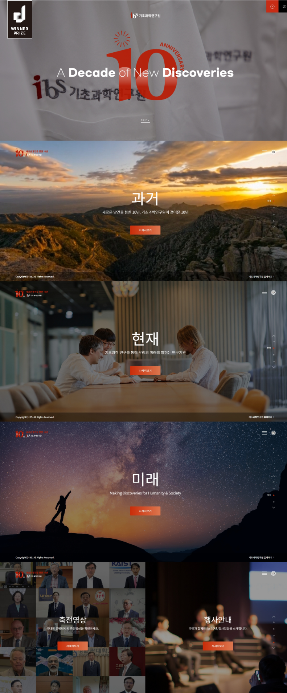
### 디자인
- 색상: 검은 오버레이로 어둡게 처리한 풀블리드 사진, 흰색 텍스트, "10" 마크와 CTA 버튼에만 쓰인 적주황 강조색 하나(추정 ~#E5432A), 얇고 어두운 푸터 바.
- 타이포그래피: 인트로의 굵은 영문 디스플레이 문구("A Decade of New Discoveries", 한 줄 안에서 굵은 글씨와 얇은 글씨를 섞음), 큰 한글 섹션 제목(추정 ~60px)과 그 아래 한 줄짜리 작은 보조 문구.
- 톤 & 이미지: 영화 같고 차분함. 해 질 녘 풍경(과거), 일하는 사람들(현재), 은하수 아래의 사람(미래). 우주 이미지를 "미래/우주"에 사용 — 우주로 끝나는 마무리에 잘 어울림.
### 레이아웃
- 구조: 인트로 스플래시(로고 애니메이션 + SKIP) → 풀스크린 "과거" → "현재" → "미래" → 분할 화면(축전 영상 | 행사 안내) → 모든 섹션에 푸터 바.
- 그리드 / 간격: 각 섹션 = 100vh, 콘텐츠는 가로세로 모두 가운데 정렬. 세 줄짜리 메시지 블록(제목 / 보조 문구 / 버튼) 주변에 넓은 여백.
- 컴포넌트: 작은 직사각형 강조 버튼, 활성 라벨이 표시되는 오른쪽 세로 점 내비게이션, 왼쪽 위 작은 로고, 오른쪽 위 메뉴 아이콘.
### 인터랙션
- 풀페이지 섹션 스냅(휠 한 번 = 섹션 하나, 점 내비게이션으로 추정), 건너뛰기 링크가 있는 인트로 애니메이션.
### 가져올 점
- **시간을 이야기로 만드는 구조**(과거 → 현재 → 미래)는 엔트로피의 "시간의 화살"과 역사 연표에 그대로 연결됩니다.
- 긴 원페이지에서 진행 상황을 보여주는 섹션 라벨 달린 오른쪽 점 내비게이션.
- 기본 섹션 단위로 쓰는 3줄 메시지 블록(큰 제목 / 한 문장 / 버튼 하나).
### 피할 점
- 강제 풀페이지 스냅: 모바일에서 독자를 가두고 스냅 사이의 콘텐츠를 가릴 수 있습니다. 대신 일반 스크롤 + 등장 효과를 쓰세요.

## 2. Space Hub (한화)
- 링크: https://www.dbcut.com/websites/24350 (실제 사이트: https://www.hanwhaspacehub.com/)
- 스크린샷: 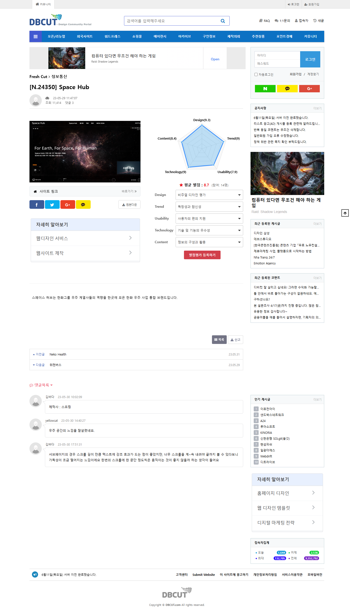 · 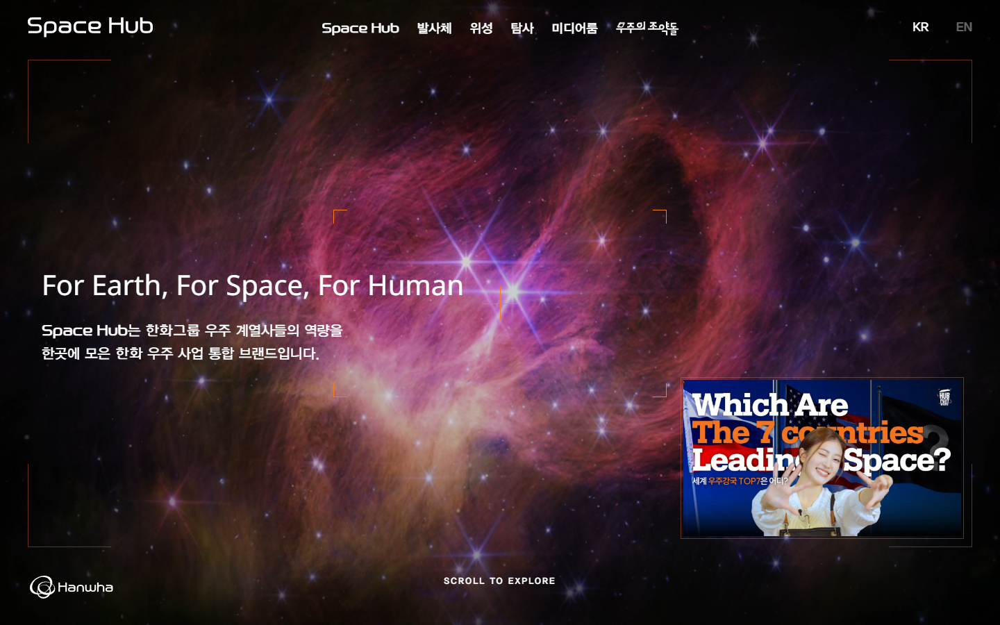 · 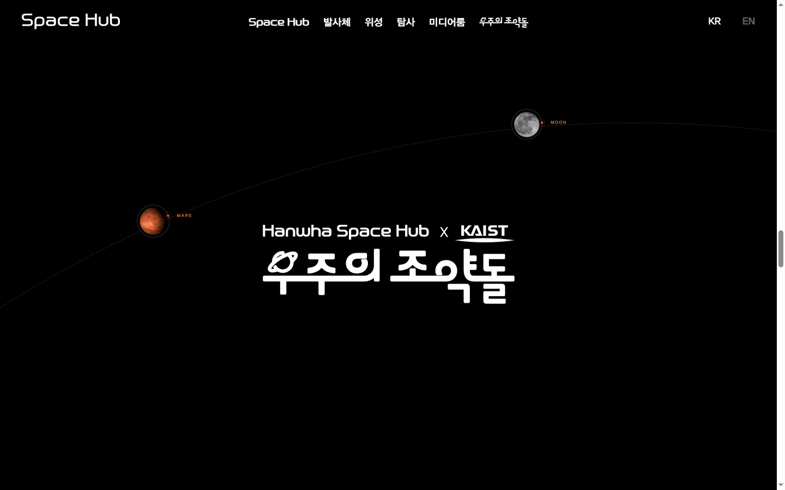
### 디자인
- 색상: 순수한 검정 페이지 배경(측정값 `rgb(0,0,0)`), 히어로의 마젠타/보라 성운 이미지, 얇은 주황 모서리 괄호와 작은 주황 라벨(추정 ~#D2692E), 흰색 텍스트.
- 타이포그래피: 브랜드와 내비게이션에 기하학적인 테크노 스타일 디스플레이 서체(커스텀 폰트 패밀리 "YDIYGO" 측정), 히어로 헤드라인 Noto Sans 40px(측정), 스토리 제목 28px(측정), 본문 16~20px.
- 톤 & 이미지: 영화 같은 우주 — 성운, 로켓 발사, 지구, 달 탐사차. 매우 어둡고 대비가 강함.
### 레이아웃
- 구조: 고정 투명 헤더(로고 / 가운데 내비게이션 / KR-EN) → "뷰파인더" 모서리 프레임과 하단 "SCROLL TO EXPLORE"가 있는 풀스크린 히어로 → 고정된 긴 스크롤 장면(발사 → 지구 → 달) → 궤도 경로 위 행성이 있는 프로그램 소개 → 큰 워드마크가 있는 푸터.
- 그리드 / 간격: 히어로 텍스트는 가장자리에서 ~60px 떨어진 왼쪽 정렬, 스크롤 장면은 가운데 정렬, 장면 사이에 넉넉한 검은 여백.
- 컴포넌트: 모서리 괄호 프레임(HUD 느낌), 히어로 오른쪽 아래 작은 영상 카드, 행성 노드와 작은 주황 라벨(MARS, MOON)이 달린 점선 궤도.
### 인터랙션
- 스크롤 기반 장면: 이미지와 텍스트는 해당 장면이 화면에 있을 때만 나타남(스크롤해야 보이기 때문에 전체 페이지 캡처는 대부분 검정).
- 스크롤에 따라 행성이 점선 궤도를 따라 이동.
### 가져올 점
- 물리학의 "측정 기기" 모티프로 히어로를 감싸는 **HUD 모서리 괄호 프레임**.
- **라벨 달린 노드가 있는 궤도/호 경로**: 연표 경로(카르노 → 클라우지우스 → 볼츠만 → 깁스 → 섀넌) 또는 빅뱅에서 열죽음까지의 "우주 연표"로 재사용.
- 히어로의 "스크롤해서 살펴보기" 안내.
### 피할 점
- 아주 긴 빈 검정 스크롤 구간(DBCUT 댓글에서도 스크롤이 너무 길어 가독성이 떨어진다고 지적). 고정 장면은 짧게 하고, JS가 실패해도 애니메이션 없이 텍스트가 보이게 하세요.

## 3. 한화 우주의조약돌 (Hanwha Space Pebble × KAIST)
- 링크: https://www.gdweb.co.kr/sub/view.asp?Txt_fgbn=5&str_no=19386 (실제 사이트: https://www.thespacekids.com/main)
- 스크린샷: 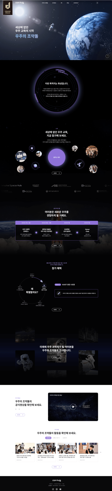 · 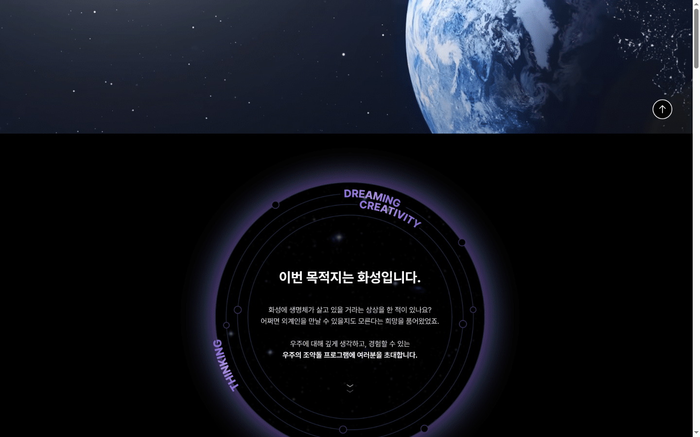 · 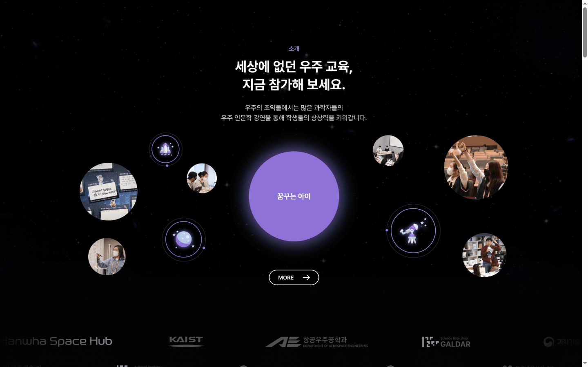 · 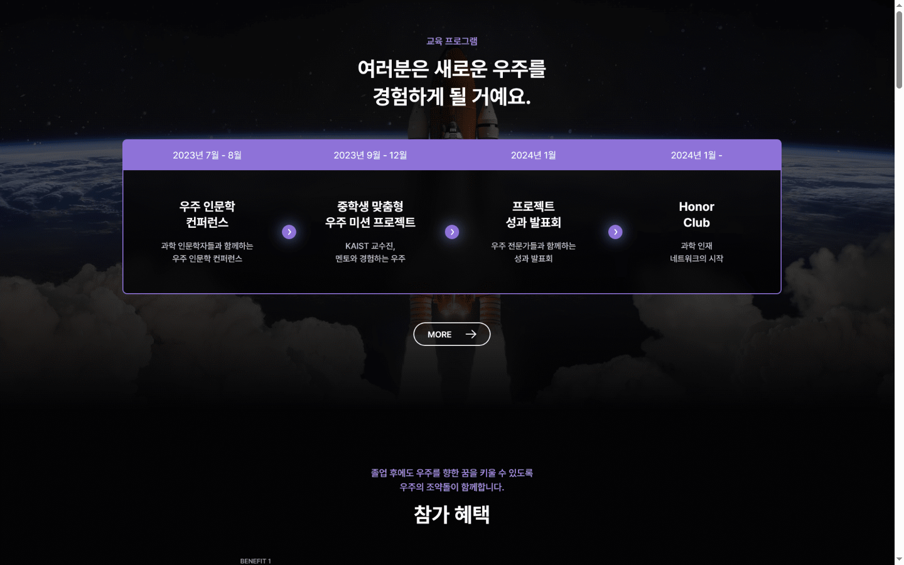
### 디자인
- 색상: 검정/아주 어두운 네이비 배경(추정 #000–#0B0B14), 라벨·가운데 원·연표 헤더 바·화살표 점에 쓰인 부드러운 보라 강조색 하나(추정 ~#8B6FDF), 흰색 제목, 연회색 본문(추정 ~#C9C9D1), 끝부분 미디어/뉴스용 흰색 섹션.
- 타이포그래피: 깔끔한 한글 산세리프(Pretendard 계열, 추정), 가운데 정렬된 굵은 2줄 섹션 제목(~36–40px 추정)과 그 위의 작은 보라 아이브로 라벨("소개", "교육 프로그램"), 본문 ~15–16px, 가운데 정렬 2줄.
- 톤 & 이미지: 교육적이고 친근하지만 여전히 우주적 — 지구, 우주인, 로켓, 그리고 학생 사진이 담긴 둥근 버블과 라인 아이콘(로켓, 달, 망원경).
### 레이아웃
- 구조: 히어로(지구 + 우주인, 왼쪽에 큰 3줄 한글 제목) → 회전하는 링 텍스트가 있는 원형 "미션" 패널 → 떠 있는 사진/아이콘 버블에 둘러싸인 가운데 보라 원이 있는 소개 → 파트너 로고 마키 → 4단계 프로그램 연표 → 원형 혜택 다이어그램 + 상세 카드 → 사진 콜라주 위 CTA → 영상 블록 → 뉴스 카드 → 푸터.
- 그리드 / 간격: 제목은 가운데 단일 열, 둥글고 보라 테두리가 있는 박스 안의 4열 연표, 4열 뉴스 카드, 섹션 사이 넓은 세로 간격(~150–200px 추정).
- 컴포넌트: 궤도 점과 곡선 텍스트가 있는 **빛나는 링 패널**, **떠 있는 버블 클러스터**, **단계 연표 바**(날짜 헤더 행 + 원형 화살표 버튼으로 이어진 4단계), 알약 모양 외곽선 "MORE →" 버튼, 로고 마키.
### 인터랙션
- 링 텍스트는 회전하고 버블은 떠다니는 것으로 추정(정적 캡처 기준 추정), 로고 줄은 가로 마키.
### 가져올 점
- 히어로 또는 "엔트로피란?" 섹션의 틀로 쓰는 **링 패널**(안에 입자가 있는 닫힌 계의 경계).
- "단어의 역사"(1824 → 1865 → 1877 → 1948) 또는 제2법칙 단계(뜨거움 → 열이 흐름 → 온도가 같아짐 → ΔS > 0)에 쓰는 **4단계 연표 바**.
- 미시상태 시각화로 쓰는 **떠 있는 버블 클러스터**(거시상태 하나를 둘러싼 많은 작은 원).
- 섹션 헤더 패턴으로 쓰는 아이브로 라벨 + 가운데 2줄 제목, 알약 외곽선 버튼.
### 피할 점
- 모바일에서 장식용 버블/사진이 너무 많음 — 768px 미만에서는 단순한 세로 목록으로 줄이세요.

## 4. 천문우주지식정보 (KASI)
- 링크: https://www.gdweb.co.kr/sub/view.asp?Txt_fgbn=5&str_no=9047 (실제 사이트: http://astro.kasi.re.kr/)
- 스크린샷: 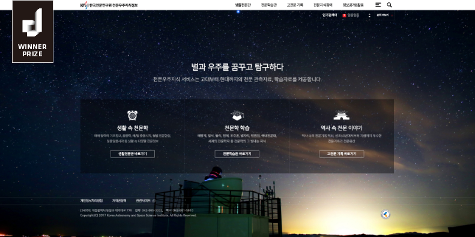
### 디자인
- 색상: 풀스크린 밤하늘 사진 한 장(짙은 네이비/파랑에 따뜻한 지평선 빛), 반투명 어두운 카드 패널(추정 rgba(0,0,0,0.45)), 흰색 텍스트, 얇은 흰색 외곽선 버튼.
- 타이포그래피: 가운데 정렬된 중간 굵기 한글 헤드라인(~32px 추정)과 회색 보조 문구 한 줄, 카드 제목 위의 작은 라인 아이콘.
- 톤 & 이미지: 조용하고 미니멀한 "별 아래에서 공부하기", 강한 사진 한 장, 군더더기 없음.
### 레이아웃
- 구조: 얇은 상단 바(왼쪽 로고, 오른쪽 4개 메뉴) → 한 화면 히어로 헤드라인 + 보조 문구 → 3열 반투명 카드 패널(아이콘 / 제목 / 2줄 설명 / 외곽선 버튼) → 같은 사진 위에 겹친 푸터 텍스트.
- 그리드 / 간격: 콘텐츠 최대 너비 ~1040px 추정, 얇은 구분선으로 나뉜 같은 너비 3열.
- 컴포넌트: 아이콘 + 제목 + 설명 + 외곽선 버튼 카드, 반투명 글래스 패널.
### 인터랙션
- 대부분 정적(한 화면 허브), 버튼 호버 상태가 있을 것으로 예상.
### 가져올 점
- "엔트로피를 보는 세 가지 방법" 섹션용 **별밭 위 반투명 글래스 카드 3개**: 에너지의 퍼짐 / 미시상태 세기 / 정보(비트).
- 라인 아이콘 한 세트만 쓴 조용하고 미니멀한 히어로 — 과학 페이지를 차분하고 읽기 쉽게 유지.
### 피할 점
- 사진 위의 작고 대비 낮은 회색 텍스트. 우리 페이지에서는 본문을 최소 16px로 하고 WCAG AA 대비를 확보하세요.

## 5. 한화에어로스페이스 (Hanwha Aerospace)
- 링크: https://www.dbcut.com/websites/24033 (실제 사이트: https://www.hanwhaaerospace.com/kor/index.do)
- 스크린샷: 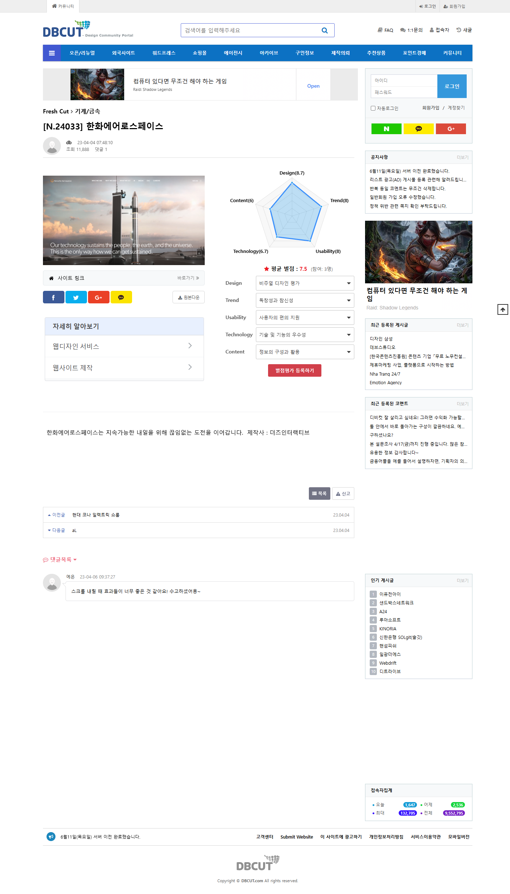 · 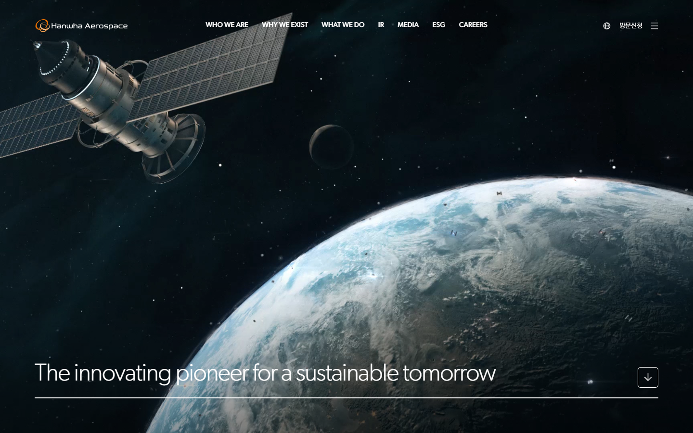 · 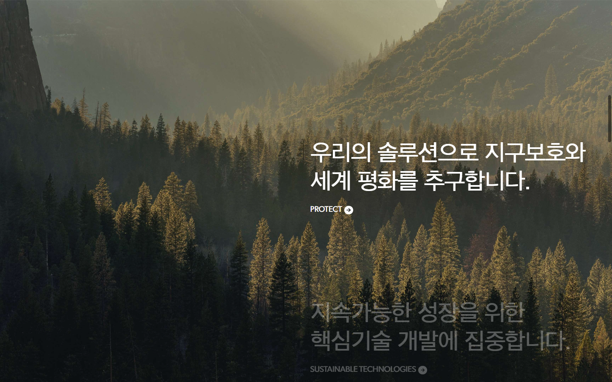
### 디자인
- 색상: 어두운 우주 영상 히어로(검정/짙은 파랑, 지구), 이어서 검정 텍스트의 흰색 섹션(측정값 `rgb(0,0,0)` 제목), 흰 텍스트가 올라간 따뜻한 숲 사진 섹션, 주황 브랜드 강조색은 로고에만.
- 타이포그래피: 기업용 한글 산세리프("HanwhaGothic" 측정), ~66px(측정)의 매우 큰 한글 섹션 제목, 자간을 좁힌 얇고 가벼운 영문 히어로 문구(~60px 추정)와 전체 너비 밑줄 선.
- 톤 & 이미지: 고급스럽고 차분하며 영화 같음. 단어는 적고 글씨는 큼.
### 레이아웃
- 구조: 투명 헤더(로고 / 대문자 메뉴 / 메뉴 아이콘) → 왼쪽 아래 한 줄 슬로건 + 정사각형 스크롤 다운 버튼이 있는 풀스크린 영상 히어로 → 거대한 2줄 헤드라인의 흰색 문장 섹션 → 안쪽 카드에서 풀블리드로 커지는 이미지 → 오른쪽에 문장이 쌓이는 고정 이미지.
- 그리드 / 간격: 좌우 여백 ~72px의 12열 느낌, 문장은 오른쪽 절반에 배치, 매우 넉넉한 여백.
- 컴포넌트: 왼쪽 아래 슬로건 + 가는 선, 정사각형 외곽선 화살표 버튼, 원형 화살표가 달린 "PROTECT →" 작은 대문자 링크.
### 인터랙션
- **스크롤에 맞춰 바뀌는 텍스트**: 현재 문장은 밝은 흰색, 다음 문장은 흐린 회색이며 스크롤하면 밝아짐.
- **스크롤 시 이미지 확장**: 안쪽의 둥근 이미지가 전체 너비로 커짐.
- 스크롤하면 헤더가 반투명(frosted) 바로 바뀜.
### 가져올 점
- 제2법칙을 한 문장씩 설명할 때 쓰는 **흐림 → 밝음 문장 등장 효과**.
- "퍼져 나감"(낮은 엔트로피 → 높은 엔트로피)의 비유로 쓰는 **카드에서 풀스크린으로 커지는 이미지/캔버스**.
- 히어로의 왼쪽 아래 큰 슬로건 + 가는 선 + 정사각형 스크롤 버튼.
### 피할 점
- 배경 영상에 지나치게 의존(모바일에서 무거움). 대신 가벼운 캔버스나 CSS 그라디언트를 쓰세요.

## 이 주제에 추천하는 방향
- **전체 톤**: "따뜻한 커피 한 잔을 든 고요한 밤하늘" — 어둡고 미니멀하며 우주적이지만, 문구는 호기심 많고 친근하게(질문형 헤드라인: "왜 커피는 저절로 다시 뜨거워지지 않을까?"). 한 화면에 한 아이디어, 큰 글씨, 적은 단어. 수식은 한 번만 보여주고 말로 풀어 설명.
- **색상 팔레트**(제안이며 어떤 사이트에서도 가져오지 않음):
  - 배경: 깊은 우주 네이비 `#0B0E1A`, 표면 `#141A2E`, 카드 글래스 `rgba(255,255,255,0.06)` + 테두리 `rgba(255,255,255,0.12)`
  - 텍스트: `#F2F4F8`(기본), `#A9B1C6`(보조)
  - 강조색 "열 / 낮은 엔트로피": 따뜻한 주황 `#FF7A3D`
  - 강조색 "퍼짐 / 높은 엔트로피": 차가운 보라-파랑 `#7C8CFF`
  - 엔트로피 미터, 연표 선, 핵심 숫자에 쓰는 그라디언트 `#FF7A3D → #7C8CFF`(열이 차가운 쪽으로 퍼지는 모습)
  - 오해 섹션용 선택적 밝은 띠: `#F5F6FA` 배경 + `#0B0E1A` 텍스트(긴 어두운 페이지에 숨 쉴 틈을 줌)
- **타이포그래피**: 한글 산세리프 **Pretendard** 또는 **Noto Sans KR**(Google Fonts) — 헤드라인 700 굵기, 데스크톱 40–64px / 모바일 28–36px(`clamp()`), 본문 17–18px, 줄 간격 1.7. 숫자와 수식은 "과학적인" 느낌을 주는 모노스페이스/고정폭 숫자 서체(예: **JetBrains Mono** 또는 **IBM Plex Mono**). 자간을 넓힌 작은 영문 대문자 아이브로 라벨(예: "01 · WHAT IS ENTROPY").
- **페이지 구조(섹션 순서)**, 리서치 계획에 맞춤:
  1. **히어로** — 풀스크린 캔버스 입자 애니메이션(입자가 한쪽 구석에 모여 있다가 천천히 퍼짐), HUD 모서리 괄호, 큰 질문형 헤드라인, 한 줄 정의, "스크롤해서 살펴보기" 안내. *(ref02, ref05)*
  2. **엔트로피란?** — 링 패널 / 닫힌 상자 프레임, 미시상태와 거시상태, "무질서는 비유일 뿐" 메모. *(ref03 링, ref04 글래스 카드 3개: 에너지의 퍼짐 / 배열의 수 세기 / 정보)*
  3. **확률로 놀아보기** — 인터랙티브 동전 카운터(슬라이더 4 → 100개, 히스토그램), S = k log W는 모노 서체로 한 번만 표시.
  4. **열역학 제2법칙** — 흐림 → 밝음 문장(뜨거움 → 차가움, 비가역, 냉장고는 일이 필요)이 있는 고정 섹션과 뜨거운/차가운 블록 데모. *(ref05)*
  5. **단어의 역사** — 연도 노드(1824, 1865, 1877, 1902, 1948)가 있는 호/선 위의 가로 연표. 데스크톱에서는 가로 스크롤, 모바일에서는 세로 목록. *(ref02 궤도 경로, ref03 단계 바)*
  6. **정보로서의 엔트로피** — 비트, 동전 던지기, 다음 글자 맞히기 미니 게임, 압축 비교 카드.
  7. **생명, 시간, 그리고 우주** — 빅뱅에서 열죽음까지 로그 스케일 우주 연표, 별밭 배경, 풀블리드로 커지는 이미지/캔버스. *(ref01 과거/현재/미래, ref05 확장)*
  8. **오해와 핵심 숫자** — 오해를 뒤집는 플립 카드 + 큰 숫자 통계 카드(1865, S = k log W, 1비트, 1.27 × 10^30분의 1, ~10^104 k, ~10^100년), 짧은 퀴즈, 출처. 마무리 문장 + 푸터.
- **핵심 컴포넌트**:
  - 섹션 진행 바가 있는 얇은 고정 헤더, 데스크톱에서는 라벨이 있는 오른쪽 **점 내비게이션**(ref01), 모바일에서는 숨김.
  - **섹션 헤더 패턴**: 번호 + 대문자 아이브로, 굵은 2줄 제목, 한 문장 리드(ref03).
  - **통계 카드**: 글래스 카드, 모노 서체의 큰 그라디언트 숫자, 한 줄 설명, 작은 출처 태그. 데스크톱 3~4열 → 태블릿 2열 → 모바일 1열(또는 가로 스와이프).
  - **연표**: 원형 노드와 연도 라벨이 있는 선/호, 활성 노드는 강조색으로 빛남.
  - 보이는 컨트롤(버튼/슬라이더), 텍스트 대체 콘텐츠, 키보드 지원을 갖춘 `<canvas>` **인터랙티브 데모**.
  - 화살표가 있는 알약 외곽선 버튼, 입자 데모의 "시간 되감기" 버튼.
- **모션 / 인터랙션 아이디어**:
  - 스크롤 시 텍스트 블록 페이드/슬라이드 업(IntersectionObserver, 고정(pinning)이 필요할 때만 GSAP ScrollTrigger).
  - 통계 카드 숫자 카운트업, 입자 데모가 퍼질수록 차오르는 엔트로피 미터.
  - 포인터에 가볍게 반응하는 입자 히어로, 스크롤에 따라 연표를 따라 "흐르는" 그라디언트 선.
  - `prefers-reduced-motion`에서는 모든 모션을 끄거나 줄이고, JS 없이도 콘텐츠를 항상 읽을 수 있게.
- **피할 것**: 풀페이지 스크롤 강제(하이재킹), 아주 긴 빈 스크롤 구간, 무거운 배경 영상, 사진 위의 작고 대비 낮은 회색 텍스트, 그리고 레퍼런스의 로고·텍스트·사진·코드 복사(레퍼런스는 패턴 참고용일 뿐).
